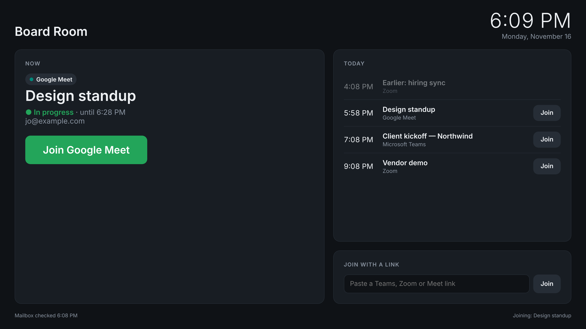

# Meeting Box

Turn one PC into a room device with its own email address. Invite the room to a
Teams, Zoom or Google Meet meeting like any other person. It accepts the
invite, puts the meeting on its touchscreen, and joins it with one tap.

```
 Organizer (Outlook, Gmail, Zoom…)          The room PC
 ───────────────────────────────           ──────────────────────────────────────
  invites boardroom@yourco.com  ──email──▶  reads the inbox every minute
                                ◀─email───  replies "Accepted" (or "Declined" if
                                            the room is already booked)
                                            shows the day on the screen
                                            tap Join → opens Zoom / Teams / Meet
```

What it handles:

- **All three platforms (plus Webex).** It finds the join link wherever the invite puts it: Outlook's Teams fields, a Zoom link in the location, or the Meet link Google attaches.
- **Auto-accept and decline conflicts.** The organizer gets a normal calendar reply. If the room is already booked, the invite is declined (you can turn this off).
- **Recurring meetings, reschedules and cancellations**, including cancelling a single occurrence.
- **Ad-hoc calls.** Paste any meeting link into the screen.
- **Optional allow-list** so only invites from your own domain(s) are accepted.
- **Optional auto-join** at start time, for rooms where nobody wants to tap anything.



---

## 1. Hardware

Any Windows 11 PC that can run Zoom and Teams works. A good room setup:

| Part | Suggestion |
|---|---|
| PC | Mini PC, Core i5 / Ryzen 5 class, 16 GB RAM, 512 GB SSD, wired Ethernet |
| Camera + mics + speaker | A USB conference bar, or a 4K webcam plus a USB speakerphone for small rooms |
| Screen | TV over HDMI. A touchscreen, or a small USB touch monitor, gives you the tap-to-join button |
| Keyboard | Any small wireless one, kept for admin |

## 2. Give the room an email address

The room needs a mailbox the PC can sign in to over IMAP/SMTP.

**Google Workspace or Gmail (simplest)**
1. Create the account, e.g. `boardroom@yourcompany.com`.
2. Turn on 2-Step Verification, then create an **App password** (Google Account → Security → App passwords).
3. Use `imap.gmail.com` / `smtp.gmail.com` in the config, as in `config.example.json`.

**Any other provider with IMAP + SMTP** (Fastmail, Zoho, iCloud, your host): use its server names and an app password.

**Microsoft 365 / Exchange Online:** Microsoft has switched off password sign-in for IMAP, so use the room-mailbox route instead:
1. Create a **room mailbox** in the Exchange admin center. Exchange then auto-accepts invites and declines conflicts on its own.
2. Publish its calendar (Outlook on the web → Settings → Calendar → Shared calendars → Publish a calendar → copy the **ICS** link).
3. Leave `mailbox.enabled` set to `false` and paste the ICS link into `calendar_feeds`. The box reads the schedule from there.

You can use both: a mailbox and one or more `calendar_feeds`.

## 3. Install on the room PC

1. Install **Python 3.10+** from python.org (tick "Add to PATH"), **Google Chrome**, the **Zoom** desktop app and **Microsoft Teams**.
2. Copy this `meeting-box` folder to the PC, e.g. `C:\MeetingBox`.
3. In that folder, run:

   ```bash
   pip install -r requirements.txt
   ```

4. Copy `config.example.json` to `config.json` and fill in the room name and email address.
5. Store the mailbox app password as an environment variable, so it isn't saved in the file:

   ```bash
   setx MEETINGBOX_PASSWORD "abcd efgh ijkl mnop"
   ```

6. Open a new terminal and check that everything connects. This dry run reads the inbox and lists the coming week's meetings. It sends no replies and saves nothing:

   ```bash
   python -m meetingbox check
   ```

7. Start it for real with `start-meeting-box.bat`. To run it at sign-in, press Win + R, type `shell:startup`, and put a shortcut to the `.bat` file in that folder. Set Windows to sign in to this account automatically.

## 4. One-time app settings on the room PC

These make "tap Join" go straight into the call:

- **Zoom:** Settings → Audio → *Automatically join computer audio*. Settings → Video → turn off *Always show video preview* and select the room camera. Pick the room camera, mic and speaker in each app.
- **Teams:** sign in with the room's account if it has one. Otherwise set `"teams": "browser"` in the config, and Teams opens in Chrome as a guest.
- **Chrome:** open meet.google.com, teams.microsoft.com and zoom.us once and allow the camera and microphone, so it never asks again.
- **Windows:** turn off sleep (Settings → System → Power) and turn off notifications.

## 5. Using it

- Invite the room's address to any meeting.
- When the meeting comes up, the screen shows **Now** and a big green **Join** button.
- To start a call that isn't on the calendar, paste its link into **Join with a link**.

## Settings reference (`config.json`)

| Setting | Default | What it does |
|---|---|---|
| `room_name` | `"Meeting Room"` | Shown on screen, in accept emails and as the display name in Zoom |
| `mailbox.*` | off | IMAP/SMTP details for the room address. `username` defaults to `address`, and the password comes from `password_env` |
| `auto_accept` | `true` | Reply "Accepted" to organizers. If `false`, meetings are added silently |
| `decline_conflicts` | `true` | Reply "Declined" when an invite overlaps a meeting already booked |
| `accept_from_domains` | `[]` (anyone) | e.g. `["yourcompany.com"]` to ignore outside invites |
| `calendar_feeds` | `[]` | ICS links (e.g. a published Exchange room calendar) to read meetings from |
| `auto_join` | `false` | Join automatically at start time, without a tap |
| `join_early_seconds` | `60` | How early auto-join opens the meeting |
| `launch.zoom` / `launch.teams` | `"app"` | `"app"` opens the desktop app; `"browser"` opens the web version |
| `launch.browser_command` | system browser | The browser command used for web meetings. `{url}` is replaced by the link |

## Good to know

- **One tap is by design.** Zoom joins straight in. Teams and Meet stop at their "Join now" screen, which is also where you check camera and mic. Commercial room systems work the same way, so a room never joins a call with nobody in it. Turn on `auto_join` to get to that screen automatically.
- **When the room PC is off, nothing replies.** Invites wait in the inbox and are answered when it starts again.
- **The touchscreen page only listens on the PC itself** (`127.0.0.1`). It isn't reachable from the network.
- **The commercial alternative** is Microsoft Teams Rooms (with Direct Guest Join for Zoom and Meet) or Zoom Rooms (with Teams/Meet interop). Those are more polished but need certified hardware and a per-room licence. Meeting Box does the same core job on any PC.

## Development

```bash
pip install -r requirements.txt
python -m unittest discover -s tests -v
```
